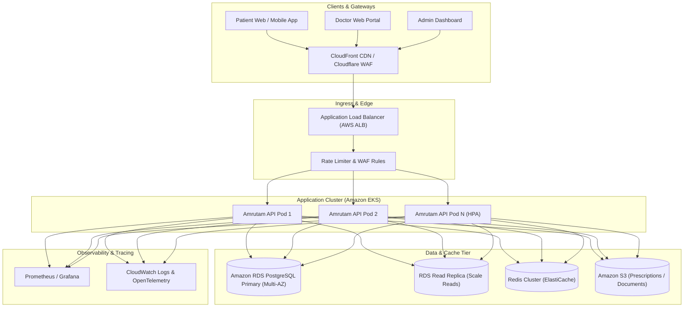
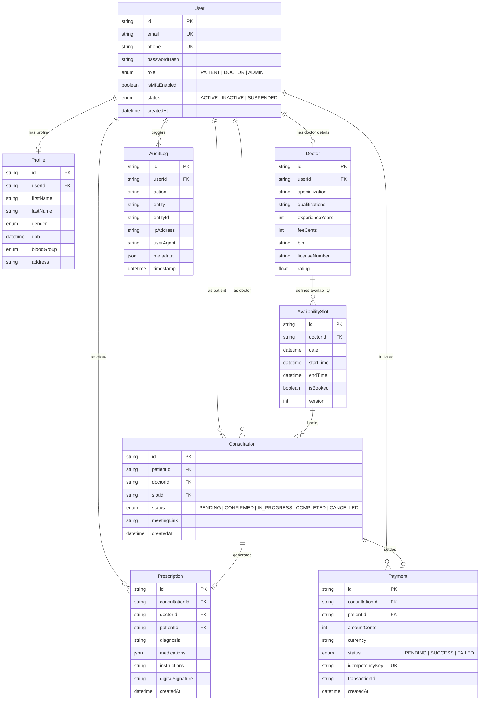
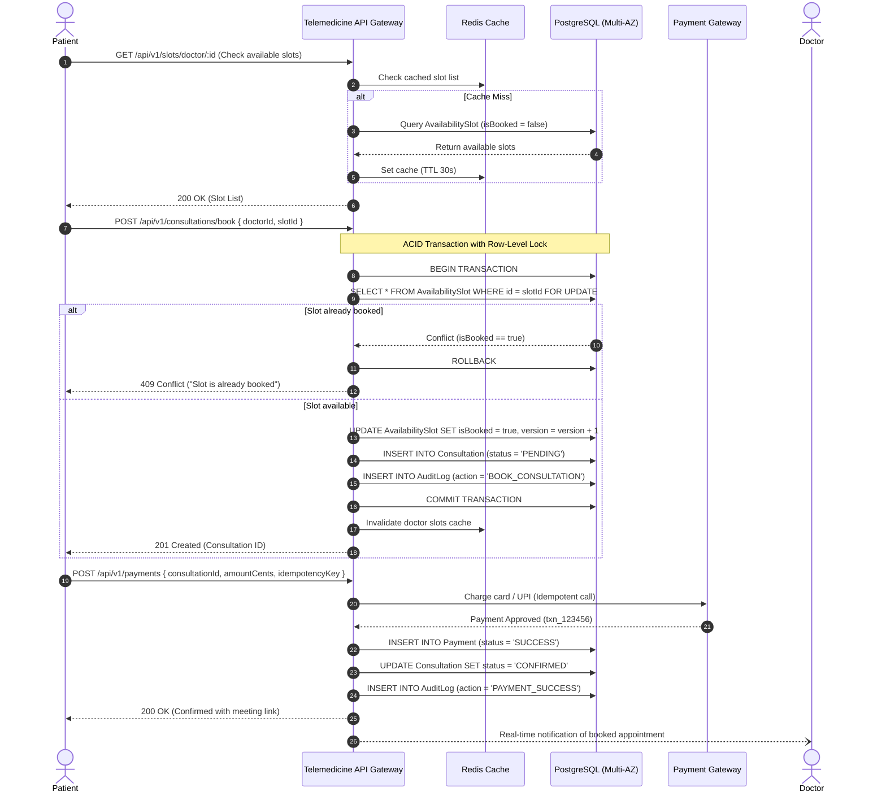

# System Architecture & Technical Design Document
## Amrutam Telemedicine Platform

---

## 1. System Overview & Scale Targets
Amrutam Telemedicine Platform is engineered as a highly scalable, fault-tolerant, resilient backend designed to handle high-concurrency telemedicine consultations, doctor availability schedules, real-time booking, digital prescriptions, and auditable financial transactions.

### Key Performance & Reliability Targets
- **Scale**: 100,000+ completed consultations per day (~1.15 sustained consultations/sec, peaking at 25-50 peak bookings/sec during morning slot openings).
- **Latency SLOs**:
  - Read queries (Doctors list, Slots, Profile): **p95 < 200ms**
  - Write transactions (Booking, Payment, Prescription): **p95 < 500ms**
- **System Availability**: **99.95%** (less than 4.38 hours downtime per year).
- **Data Durability**: Zero data loss (RPO = 0 for completed payments and consultations).

---

## 2. High-Level Architecture & Data Flow

---

## 3. Entity-Relationship (ER) Diagram

---

## 4. End-to-End Booking Flow Sequence Diagram

---

## 5. Concurrency Handling & Preventing Double-Booking
When multiple patients attempt to book the exact same slot simultaneously:
1. **Pessimistic Row-Level Locking (`SELECT ... FOR UPDATE`)**:
   - The booking transaction locks the slot record in PostgreSQL for the duration of the reservation.
   - Any concurrent transaction attempting to read or update that row waits until the transaction completes.
2. **Optimistic Versioning (`version` column)**:
   - Every `AvailabilitySlot` includes an incrementing `version` integer.
   - Updates enforce `WHERE id = :slotId AND isBooked = false AND version = :currentVersion`.
3. **Cache Invalidation & Redis Distributed Locks**:
   - Once booked, the Redis key `slots:doctor:{id}:{date}` is immediately invalidated.

---

## 6. Data Partitioning & Scale Strategy (100k Daily Consultations)
To sustainably scale past 100k daily consultations (~3M/month, ~36M records/year):
1. **Partitioning Strategy**:
   - **Range Partitioning by Month**: The `Consultation`, `Payment`, and `AuditLog` tables are partitioned by `createdAt` range (`PARTITION BY RANGE (createdAt)`).
   - Monthly partitions allow PostgreSQL query planner to perform partition pruning, isolating queries to current month tables.
2. **Read/Write Splitting**:
   - Write operations (Bookings, Consultations, Payments) route to the PostgreSQL Primary database.
   - Read queries (Doctor directories, slot listings, patient medical history) route to Read Replicas via connection pooler (PgBouncer).
3. **Archival & Hot/Cold Tiering**:
   - Closed consultations and payments older than 180 days are offloaded to cold storage (Amazon S3 via parquet exports) for compliance and analytics, keeping operational indexes compact in RAM.

---

## 7. Distributed Transaction Management & Sagas
In distributed multi-step operations (Booking -> Payment Authorization -> Notification -> Confirmation):
- **Orchestration Saga Pattern**:
  - If payment authorization fails or times out, a compensating transaction executes:
    1. Mark consultation as `CANCELLED`.
    2. Revert `AvailabilitySlot.isBooked` to `false`.
    3. Issue refund if captured partially.
    4. Append compensation record to `AuditLog`.
- **Idempotency Guarantees**:
  - Payment requests require an `Idempotency-Key` UUID.
  - Duplicate submissions with the same key return the stored transaction response without double-charging.

---

## 8. Retry & Backoff Strategies
- **Exponential Backoff with Jitter**:
  - Transient external failures (Payment Gateway, SMS/Email delivery) use exponential backoff:
    $$T_{\text{wait}} = \min(M, B \times 2^{\text{attempt}}) \pm \text{jitter}$$
- **Circuit Breaker Pattern**:
  - If external service failure rate exceeds 50% over a 30-second window, circuit trips open for 15 seconds to prevent cascading resource starvation.

---

## 9. Backup & Disaster Recovery (DR) Strategy
- **Recovery Objectives**:
  - **RPO (Recovery Point Objective)**: < 1 minute (Continuous WAL archiving to Amazon S3).
  - **RTO (Recovery Time Objective)**: < 15 minutes (Automated RDS Multi-AZ failover).
- **Automated Backup Strategy**:
  - Daily snapshot backups retained for 35 days.
  - Multi-Region replication to secondary AWS region (e.g. `ap-south-1` to `ap-southeast-1`).
  - Quarterly automated disaster recovery drill validating point-in-time recovery (PITR).
